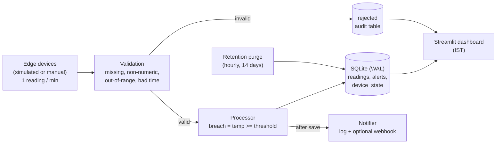
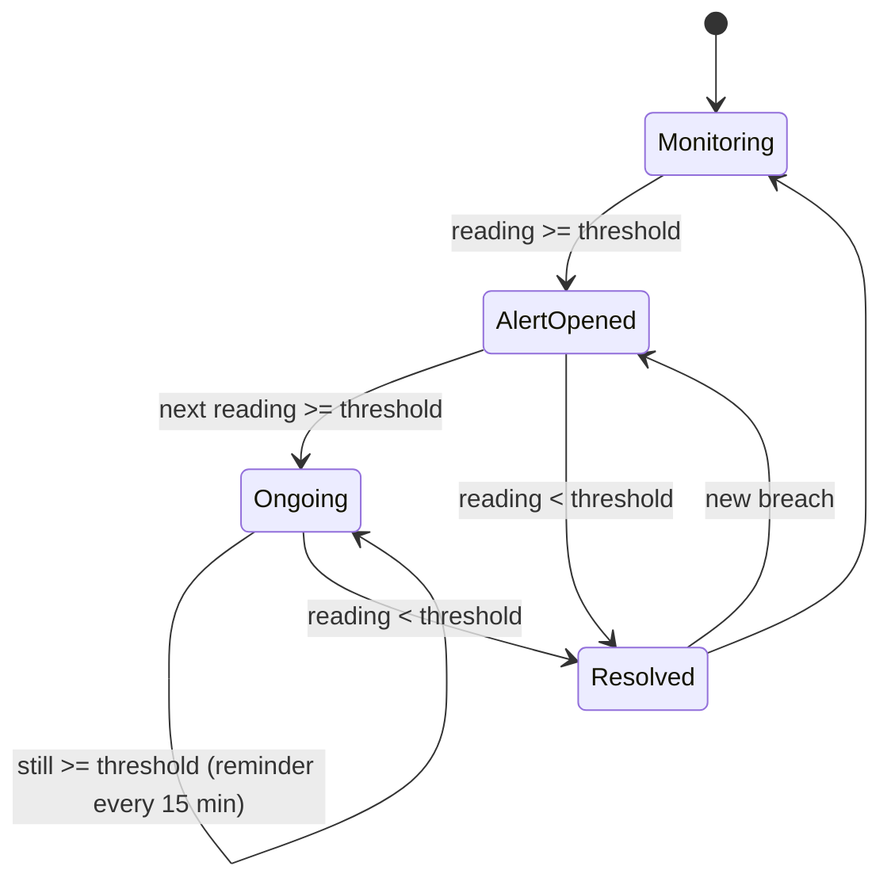

# 🌡️ Real-Time Temperature Monitoring & Alert System

A real-time monitoring system for edge-device temperature readings (°C, one per minute). It checks every reading against a threshold, raises an alert when `temperature >= threshold`, keeps 14 days of data, and shows everything on a live **Streamlit** dashboard. **All dates and times are shown in IST (UTC+05:30).**

  -003b57) 

---

## ✨ Features

| Area | What it does |
|---|---|
| **Threshold alerting** | Alert when a reading **reaches or exceeds** the threshold (`>=`), otherwise keep monitoring |
| **Alert lifecycle** | Opens on first breach, reminder at most every 15 min, resolves when back below threshold |
| **Data validation** | Rejects missing, non-numeric, out-of-range and badly timestamped readings, never alerts on them |
| **14-day retention** | Hourly purge of older data, history lookup by device and IST date range, CSV export |
| **Reliability** | Duplicate readings ignored, late readings stored safely, alert-channel failures never lose data |
| **Offline detection** | A device with no reading for 3 minutes shows as OFFLINE |
| **Live dashboard** | Key numbers and breach banner always on top, then one page per topic |
| **Manual reading** | Send a single reading by hand to test validation and alerts |
| **Alert beep** | Optional sound when a new alert opens |

---

## 🏗️ Architecture



### Data flow

1. A device sends `{device_id, timestamp, temperature_c}`.
2. **Validate:** device id present, temperature numeric and in range, timestamp valid, not in the future, not older than 14 days. Bad readings go to the `rejected` table with a reason and stop there.
3. **Evaluate:** `breach = temperature_c >= threshold`.
4. **Save:** the reading is stored with its breach flag. A repeat of the same device and time is ignored.
5. **Update state:** the per-device alert lifecycle moves forward (below).
6. **Notify:** alert messages are sent after the data is saved, so a failing channel cannot lose a reading.
7. **Show:** the dashboard reads the same database and refreshes automatically.

### Alert lifecycle (per device)



### Data model (SQLite)

| Table | Purpose | Key |
|---|---|---|
| `readings` | Every valid reading with a `breach` flag | `(device_id, ts)`, makes inserts idempotent |
| `alerts` | Alert history: opened, resolved, peak, breach count | `id` |
| `device_state` | Latest reading and breach status per device, so evaluation is O(1) | `device_id` |
| `rejected` | Audit trail of invalid readings with reason code and payload | `id` |

Timestamps are stored as UTC epoch seconds and converted to IST for display. Naive ISO timestamps from devices are read as IST.

---

## 📁 Project structure

```
temperature-monitor/
├── app.py                    # Streamlit dashboard
├── requirements.txt
├── README.md
├── data/
│   └── sample_readings.csv   # sample test data (breaches, bad readings, duplicate)
├── scripts/
│   ├── run_simulator.py      # headless device simulator
│   ├── ingest_file.py        # replay a CSV / JSONL of readings
│   └── benchmark.py          # ingest throughput benchmark
├── tempmon/
│   ├── config.py             # settings (environment variables)
│   ├── validation.py         # reading validation
│   ├── processor.py          # threshold check + alert lifecycle
│   ├── store.py              # SQLite storage and retention
│   ├── notifier.py           # alert channels (log, webhook)
│   ├── simulator.py          # edge-device simulator
│   ├── runtime.py            # wiring helpers
│   └── timeutil.py           # IST helpers
└── tests/                    # 41 automated tests
```

---

## 🚀 Quick start

**Requirements:** Python 3.10 or newer.

```bash
# 1. Create and activate a virtual environment
python -m venv .venv
source .venv/bin/activate          # Windows: .venv\Scripts\activate

# 2. Install packages
pip install -r requirements.txt

# 3. Start the dashboard
streamlit run app.py
```

The dashboard opens at <http://localhost:8501>.

### Using the dashboard

Nothing starts automatically. In the sidebar:

1. Set **Edge devices** (for example 12).
2. Choose **Cadence**: *Demo* (a reading every 5 seconds) or *Real-time* (every minute).
3. Choose **Backfill history**: 0 hours, or more for past simulated data.
4. Click **▶ Start / Restart**.

**Always on top:** Devices online, Active alerts, Readings stored, Rejected (24h), Oldest data, and a red banner listing devices in breach.

**Pages (tabs below):**

| Page | Shows |
|---|---|
| 📋 Fleet status | Large colour-coded table of every device, with counts of OK, in alert and offline |
| 🚨 Live alert feed | Alert, reminder and resolved messages as they happen |
| 📈 Live temperature | Chart for one device with the threshold line, plus latest, min, max and breach count |
| 🗂️ History (14 days) | Pick a device and an IST date range, chart the readings, download CSV |
| 📜 Alert history | Open and resolved alerts with duration, peak temperature and breach count |
| 🧹 Data quality | Rejected readings and the reason for each |
| ✍️ Manual reading | Send one reading by hand (see below) |
| ⚙️ System | Current settings |

**Manual reading.** Enter a device ID and a temperature, then click **Send reading**. It goes through the same validation, threshold check and alert logic as simulated readings.
- Use a device ID the simulator does not use (the default `manual-01` is fine), otherwise the next simulated reading can close the alert within seconds.
- The temperature box defaults to 2 °C above the threshold, so the first click opens an alert.
- Type `ERR`, leave it blank or enter `999` to see an invalid reading rejected. It appears on the Data quality page.

**Beep.** Turn on **🔔 Beep when a new alert opens** in the sidebar. It plays once per newly opened alert, not for reminders or when a device is already in alert. Browsers may block sound until you click once on the page.

**Other sidebar controls:**
- The **Threshold** slider changes the alert rule immediately. Drag it down (for example to 30 °C) to see alerts quickly.
- **Run retention purge now** deletes data older than 14 days.
- **Clear all data** (tick the box first) empties the database.

### Other commands

```bash
# Replay the sample data (prints {'ok': 12, 'rejected': 5, 'duplicate': 1})
python scripts/ingest_file.py data/sample_readings.csv

# Headless simulator: 50 devices, real-time cadence, 24 h of history
python scripts/run_simulator.py --devices 50 --interval 60 --backfill-hours 24

# Ingest throughput benchmark
python scripts/benchmark.py --devices 1000 --minutes 10
```

The dashboard and the scripts share `data/tempmon.db`, so data from one appears in the other.

---

## ⚙️ Configuration

Set environment variables before starting.

| Variable | Default | Meaning |
|---|---|---|
| `TEMPMON_THRESHOLD_C` | `40` | Alert when temperature is at or above this (°C) |
| `TEMPMON_RETENTION_DAYS` | `14` | How long data is kept |
| `TEMPMON_RENOTIFY_MIN` | `15` | Reminder interval while a breach continues |
| `TEMPMON_OFFLINE_SEC` | `180` | No reading for this long means OFFLINE |
| `TEMPMON_MIN_VALID_C` / `TEMPMON_MAX_VALID_C` | `-50` / `150` | Plausible sensor range; outside is rejected |
| `TEMPMON_FUTURE_SKEW_SEC` | `120` | Tolerated device clock error |
| `TEMPMON_WEBHOOK_URL` | none | Optional Slack, Teams or PagerDuty-style webhook |
| `TEMPMON_DB` | `data/tempmon.db` | Database path |

```bash
# Example (Windows PowerShell: $env:TEMPMON_THRESHOLD_C="35")
TEMPMON_THRESHOLD_C=35 streamlit run app.py
```

---

## 🧪 Testing

```bash
python -m pytest -v
# or without pytest:
python -m unittest discover -s tests -t .
```

**41 tests** cover:

- **Normal readings:** below threshold means no alert and monitoring continues.
- **Threshold breaches:** just below, exactly at, and above the threshold, plus a custom threshold.
- **Alert generation:** open, reminder, resolve, a new breach after resolving, and independent devices.
- **Invalid or missing readings:** missing, empty, non-numeric, NaN, infinite, boolean, out-of-range, missing device, bad payload and bad timestamps. None of them alert or clear an alert.
- **Data retention:** the 14-day boundary, purge, history queries, open alerts kept, and writes older than 14 days rejected.
- **Edge cases:** duplicate delivery, out-of-order readings, notifier failure, offline detection, small clock skew, epoch milliseconds, and IST and UTC timestamp handling.
- **End to end:** the sample CSV, a seeded simulator, and a 50-device volume run.

---

## 📈 Performance

`scripts/benchmark.py` pushes readings through the full pipeline (validate, evaluate, save, alert logic) in one process. On a laptop (Windows, single process) it handled about **3,300 readings per second**. At one reading per device per minute, 10,000 devices need only about 167 readings per second. Results vary by machine, so run the benchmark yourself.

| Devices | Readings per second needed | Readings in 14 days |
|---|---|---|
| 1,000 | about 17 | about 20 million |
| 10,000 | about 167 | about 200 million |
| 100,000 | about 1,700 | about 2 billion |

---

## 🧠 Design decisions

| Decision | Why | Trade-off |
|---|---|---|
| SQLite (WAL mode) | Runs anywhere with no setup | One machine and one writer, not for very large fleets |
| Alert on state change plus reminders | Fast alert without an alert storm | A little state to track per device |
| Reject out-of-range readings | Faulty sensors do not cause false alarms | A real reading beyond the range would be rejected, so the range is configurable |
| Notify after saving | A failing channel cannot lose data | The alert goes out a moment after the save |
| Store UTC, show IST | No time-zone confusion in the data | Conversion needed for display |
| Simulator instead of real devices | Repeatable demos and tests | No real network ingestion yet |

---

## ⚠️ Current limitations

- Devices are **simulated** (plus manual readings from the dashboard). There is no network ingest endpoint or device authentication yet.
- Alerts go to a log, an optional webhook, the dashboard and an optional beep. Email and SMS are not built in.
- It runs on one machine with one database.
- A device hovering around the threshold can open and close alerts repeatedly.

---

## 🔮 Future enhancements (scalability and cost)

None of these are built yet. The examples are typical uses, given for illustration.

| Enhancement | Scalability benefit | Cost benefit | Real-life example |
|---|---|---|---|
| Real device ingestion over MQTT or HTTPS | Thousands of devices connect securely | Pay only for the messages sent | Smart-building sensors commonly publish to an MQTT broker |
| A message stream (Kafka or Kinesis) before processing | Absorbs bursts and lets processors catch up | No lost readings, so no repeat work | Every sensor reconnects at once after a power cut |
| Several processors split by device id | Add processors as devices grow, each device stays in order | Scale up only when needed | A fleet growing from 10,000 to 20,000 devices |
| A distributed database with automatic 14-day expiry | Handles billions of readings | No cleanup jobs, storage stays at 14 days | A cold-chain operator with thousands of fridges and trucks |
| Managed alert delivery (SMS, email, on-call tools) | Reaches many people reliably | Pay per alert, de-duplication keeps volume low | A server room overheats and the on-call engineer is paged |
| Per-device or per-zone thresholds | One system serves different equipment | No extra infrastructure | Vaccine fridges must stay within 2–8 °C, unlike a server room |
| Consecutive-readings (hysteresis) rule | Fewer repeat alerts | Fewer SMS and emails | A door left open briefly should not page staff |
| Archive old data to cheap object storage | Long-term analysis without slowing the live store | Cold storage costs a fraction of a database | Monthly compliance reports |
| Local buffering on the device | No data lost when the network drops | Fewer gaps to investigate | A delivery truck passing through an area with no signal |

---

## 🛠️ Troubleshooting

| Problem | Fix |
|---|---|
| `ModuleNotFoundError: tempmon` | Run commands from the folder that contains `app.py` |
| All devices show OFFLINE | The simulator is not running. Click **▶ Start / Restart**, or **Clear all data** to remove old readings |
| Manual alert disappears after a few seconds | The device is also sent by the simulator. Use another device ID such as `manual-01` |
| No beep | Turn on the sidebar toggle, click once on the page, and remember it only plays when a new alert opens |
| Port already in use | `streamlit run app.py --server.port 8502` |
| Dashboard looks stale after a code change | Stop it with Ctrl+C, delete `data/tempmon.db`, and start again |

---

## 📄 License

Add a license of your choice (for example MIT) before publishing.